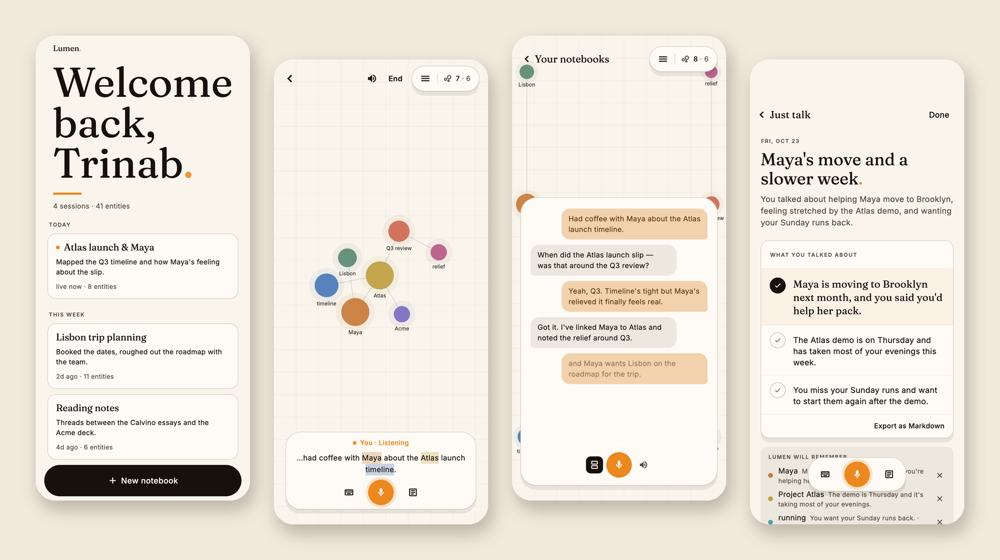
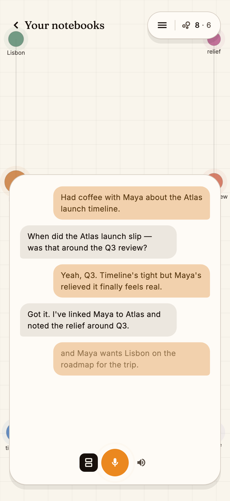
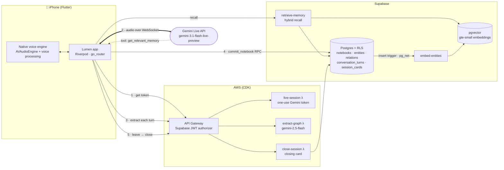

<div align="center">

# Lumen<span>.</span>

### Talk through your week. Lumen remembers what matters.

A voice-first companion for iPhone. Speak naturally, and Lumen listens,
asks good follow-up questions, and quietly builds a living map of the
people, projects and places in your life.

[](https://flutter.dev)
[](ios/Runner/VoiceEnginePlugin.swift)
[](https://ai.google.dev/gemini-api/docs/live)
[](supabase/)
[](infra/)

[**User guide**](docs/guide/user-guide.md) ·
[**Architecture**](docs/guide/architecture.md) ·
[**Getting started**](docs/guide/getting-started.md) ·
[**Backend**](docs/guide/backend.md) ·
[**Testing**](docs/guide/testing.md) ·
[**Design system**](docs/guide/design-system.md)

<br>



</div>

## Table of contents

- [Why Lumen?](#why-lumen)
- [Features](#features)
- [Conversation modes](#conversation-modes)
- [How it works](#how-it-works)
- [Quick start](#quick-start)
- [Repository layout](#repository-layout)
- [Documentation](#documentation)
- [Security model](#security-model)
- [Project status](#project-status)
- [Contributing](#contributing)

## Why Lumen?

Journaling apps ask you to write. Most people would rather talk. Chat
assistants talk back, but forget you the moment the window closes.

Lumen sits in between. It is a **real-time voice conversation** (interruptible,
with on-device echo cancellation) that leaves behind
**structured memory you can see and edit**: every person, project, place and
feeling you mention becomes a node in a knowledge graph, linked to the moments
you said it. Next time you talk, Lumen recalls what's relevant: "Last week you
said the staging DB access was still pending. Did that land?"

- **Voice first, typing welcome.** Talk, or switch to the keyboard mid-session.
- **Memory you control.** See everything Lumen keeps, rewrite a description, or
  remove an entity so it never comes back.
- **A result, not a transcript.** Every conversation ends on a *closing card*:
  a title, a short summary, the key points, and what Lumen will remember.
- **Yours to take.** Export any notebook as Markdown, Obsidian-style
  `[[wikilinks]]` included.

## Features

<table>
<tr>
<td width="50%" valign="top">

**Notebooks dashboard**

Every conversation is a *notebook*, grouped by Today, This week and Earlier,
with a one-line summary and how many entities it produced. Tap one to resume
it, or start a new one.

</td>
<td width="50%" valign="top">

**Live transcript with entity highlights**

While you speak, the voice dock shows your words as they're recognized.
Names Lumen has picked up are highlighted in their entity colour as they enter
the graph.

</td>
</tr>
<tr>
<td></td>
<td></td>
</tr>
<tr>
<td valign="top">

**The graph, in the room with you**

A force-directed canvas on a paper grid. People, places, projects, events,
organizations, activities, concepts and emotions each get a colour. Tap a node
to read its note.

</td>
<td valign="top">

**Transcript page**

Expand the dock into a full conversation view. You and Lumen alternate as
chat bubbles over the graph. A turn still being recognized shows faded.

</td>
</tr>
<tr>
<td></td>
<td></td>
</tr>
<tr>
<td valign="top">

**Graph drawer and export**

Everything in the notebook, grouped by type and ranked by mentions, with a
one-tap **Export notebook** to Markdown.

</td>
<td valign="top">

**Closing cards**

Leaving a notebook lands on its card. *Lumen will remember* lists the memory
changes, each removable, with a five-second undo.

</td>
</tr>
<tr>
<td></td>
<td></td>
</tr>
</table>

See the [user guide](docs/guide/user-guide.md) for a full tour, including every
voice dock state.

## Conversation modes

Each notebook has a `conversation_mode` that shapes Lumen's opening, its
questions, and the closing card it produces.

| Mode | What it's for | Closing card | Status |
| --- | --- | --- | --- |
| **Just talk** | Open-ended talk about your day or week | Title, summary, *what you talked about* | ✅ Shipped (default) |
| **Weekly debrief** | Capture wins for your review brief | Top win + wins list, *Copy bullets* | 🚧 Card contract ready |
| **Session prep** | Prepare for an upcoming one-on-one or session | Themes gathered across recent notebooks | 🚧 Card contract ready |
| **What landed** | Reflect right after that session | What came up, and what carries forward | 🚧 Card contract ready |
| **First session** | Lumen's first conversation with you | The first people and projects it remembers | 🚧 Card contract ready |

Card shapes for all five modes live in
[`contracts/session-card-v1.schema.json`](contracts/session-card-v1.schema.json),
with one fixture per mode.

## How it works



1. **Talk.** The app asks the runtime for a one-use, 30-minute Gemini Live token. The
   permanent API key never leaves AWS Secrets Manager. It then streams 16 kHz
   mic audio straight to Gemini and plays 24 kHz audio back through a single
   native `AVAudioEngine`, so the echo canceller hears exactly what the
   speaker plays.
2. **Extract.** After each finished turn, the conversation goes to the
   `extract-graph` Lambda, which returns a validated *graph patch* (entities,
   relations, follow-ups). Retries are idempotent through a DynamoDB claim
   store.
3. **Commit.** The patch is written with the `commit_notebook` RPC: one
   transaction, ownership-checked by row-level security, revision-numbered.
4. **Recall.** Mid-conversation, Gemini can call `get_relevant_memory`.
   The `retrieve-memory` Edge Function blends lexical graph search with
   pgvector similarity across *all* the user's notebooks.
5. **Close.** Leaving a notebook calls `close-session`, which writes the
   mode-specific closing card to `session_cards`.

Read [Architecture](docs/guide/architecture.md) for the turn lifecycle, the
data model and the design decisions behind each layer.

## Quick start

> **Prerequisites:** Flutter ≥ 3.22 with Xcode (iOS 16+ simulator or device),
> Node 20+, and access to a Supabase project and a deployed runtime API.
> See [Getting started](docs/guide/getting-started.md) for setting up your own backend.

```bash
git clone git@github.com:Hostileoracle0606/Lumen..git echo-insights
```

```bash
cd echo-insights && flutter pub get
```

Create `.env.dev` in the repo root. It matches the `.env.*` ignore rule and
is never bundled into the app; Flutter reads it at build time only:

```dotenv
SUPABASE_URL=https://<project-ref>.supabase.co
SUPABASE_PUBLISHABLE_KEY=<publishable-key>
NOTEBOOK_RUNTIME_URL=https://<api-id>.execute-api.<region>.amazonaws.com
```

```bash
flutter run --dart-define-from-file=.env.dev
```

The voice engine is iOS-native. Run on an iPhone or the iOS Simulator; the mic
works in the simulator through your Mac's input device.

## Repository layout

```
echo-insights/
├── lib/                 Flutter app (the product)
│   ├── audio/           Dart side of the native voice engine, PCM capture/playback
│   ├── logic/           Pure, unit-tested logic: turn state, merge, agenda, noise filter…
│   ├── models/          Entity, Relation, Notebook, SessionCard, ConversationMode…
│   ├── providers/       Riverpod state: auth, journal, notebooks, voice services
│   ├── screens/         auth · dashboard · journal · card
│   ├── services/        Gemini Live client, runtime, commit, recall, export…
│   ├── theme/           Paper-and-ink design tokens (colours, type)
│   └── widgets/         ResultCard, ContextTile, ModeHeader, NodeGlyph…
├── ios/Runner/          VoiceEnginePlugin.swift: one AVAudioEngine for mic + voice
├── supabase/
│   ├── migrations/      Schema, RLS, RPCs (commit_notebook, save_session_card…)
│   └── functions/       retrieve-memory · embed-entities · extract-graph · speak-agent
├── infra/               AWS CDK: authorizer, live-session, extract-graph, close-session
├── contracts/           Versioned JSON Schemas + fixtures shared by Dart, TS and Deno tests
├── src/                 Web client (TanStack Start + React), the original prototype
├── test/                Flutter unit, widget and preview-capture tests
└── docs/                This documentation, specs and plans
```

## Documentation

| Guide | Read it when you want to… |
| --- | --- |
| [User guide](docs/guide/user-guide.md) | See every screen and what each control does |
| [Architecture](docs/guide/architecture.md) | Understand the turn lifecycle, data model and memory |
| [Getting started](docs/guide/getting-started.md) | Run the app, and stand up your own backend |
| [Backend reference](docs/guide/backend.md) | Look up a table, RPC, Edge Function or API route |
| [Testing](docs/guide/testing.md) | Run the suites, regenerate screenshots, pass the release gate |
| [Design system](docs/guide/design-system.md) | Use colour tokens, type and motion consistently |
| [`contracts/`](contracts/README.md) | Change a cross-platform API safely |
| [`infra/`](infra/README.md) | Deploy the AWS runtime |

## Security model

- **No model keys on the device.** Production config is passed with
  `--dart-define-from-file`; `.env` files are never bundled as assets.
  `scripts/production-secrets.mjs` scans the built `Runner.app` for
  credentials in CI.
- **Short-lived voice credentials.** Gemini Live tokens are one-use, expire in
  30 minutes, and are locked to one model and audio output.
- **Row-level security everywhere.** Every table is owner-only. Writes go
  through `security definer` RPCs that re-check ownership. The runtime calls
  them with the *user's* token, not a service key.
- **Service-role islands.** Embeddings and their match function are reachable
  only by the service role, behind the `retrieve-memory` function.

## Project status

Lumen is in active development and pre-release. **Just talk** is complete
end to end. The other four modes have their data contracts and closing-card
layouts in place. Next up is a screen-aware companion mode for Mac and
iOS that shares the same master memory.

## Contributing

1. Branch from `main` (`feat/…`, `fix/…`, `docs/…`).
2. Keep logic in `lib/logic/` pure and test it. UI changes should come with an
   updated preview capture (see [Testing](docs/guide/testing.md#preview-captures)).
3. Changing an API shape? Add a new schema version in `contracts/` and follow
   the [deploy order](docs/guide/backend.md#deploy-order).
4. Run `flutter analyze && flutter test` before opening a PR.

<div align="center">
<sub>Built with Flutter, Gemini Live, Supabase and AWS.</sub>
</div>
