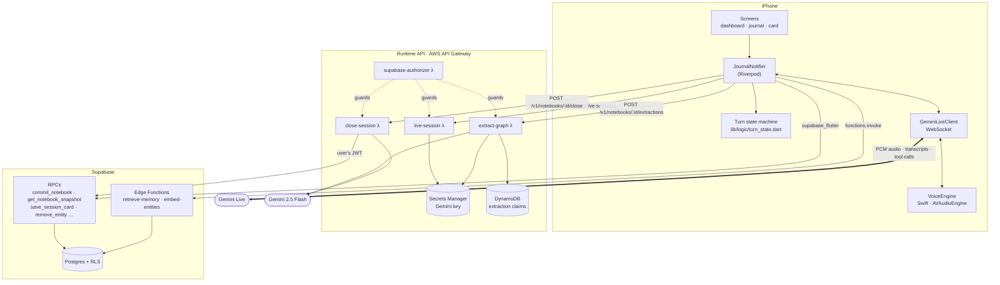
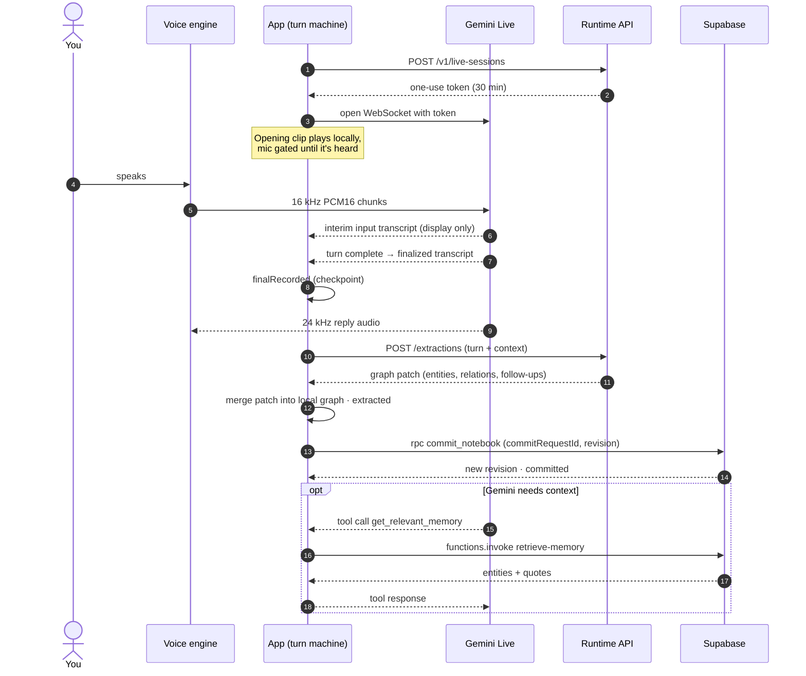
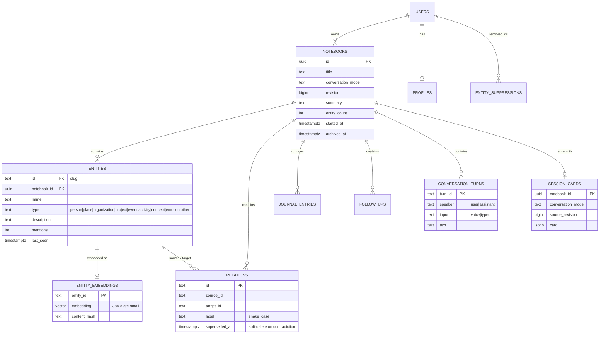
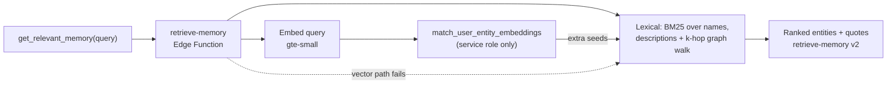
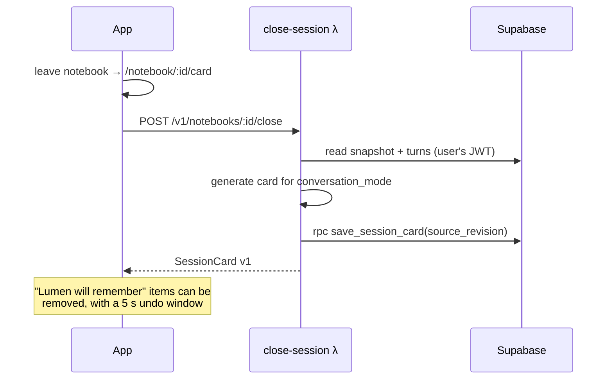

# Architecture

> Lumen has three moving parts. The **Flutter app** owns the conversation. A
> small **AWS runtime** holds the model credentials and does the heavy model
> calls. **Supabase** stores memory behind row-level security.

- [System overview](#system-overview)
- [The app](#the-app)
- [Lifecycle of a turn](#lifecycle-of-a-turn)
- [Memory: data model](#memory-data-model)
- [Recall: hybrid retrieval](#recall-hybrid-retrieval)
- [Closing a session](#closing-a-session)
- [Contracts between platforms](#contracts-between-platforms)
- [Design decisions](#design-decisions)
- [Deep dives](#deep-dives)

## System overview



| Layer | Where | Responsibility |
| --- | --- | --- |
| App | [`lib/`](../../lib) | Conversation UX, the turn state machine, the local graph, export |
| Voice engine | [`ios/Runner/VoiceEnginePlugin.swift`](../../ios/Runner/VoiceEnginePlugin.swift) | One `AVAudioEngine` for mic capture (voice processing on) and playback |
| Runtime | [`infra/`](../../infra) | Short-lived Gemini tokens, graph extraction, closing cards |
| Database | [`supabase/migrations/`](../../supabase/migrations) | Tables, RLS, transactional RPCs, embedding triggers and cron |
| Edge Functions | [`supabase/functions/`](../../supabase/functions) | Memory recall, embedding |
| Contracts | [`contracts/`](../../contracts) | JSON Schemas and fixtures that Dart, TS and Deno tests all consume |
| Web client | [`src/`](../../src) | The original TanStack Start prototype. It shares the turn-state rules with the app |

## The app

```
lib/
├── main.dart, app.dart     Bootstrap, go_router routes, auth redirect
├── providers/              Riverpod: auth, notebooks, journal, voice services, export
├── screens/
│   ├── auth/               Email + password sign-in and sign-up
│   ├── dashboard/          Notebook list, "New notebook"
│   ├── journal/            Graph canvas, voice dock, transcript page, drawer, note sheet
│   └── card/               Closing card
├── services/               I/O adapters: Gemini Live, runtime HTTP, Supabase, recall
├── logic/                  Pure rules: turn state, merge, agenda, noise filter, gates
├── models/                 JSON-serializable domain types
├── audio/                  Dart bindings for the native voice engine
└── theme/, widgets/        Design tokens and shared components
```

**Routes** ([`lib/app.dart`](../../lib/app.dart)):

| Path | Screen |
| --- | --- |
| `/auth/login`, `/auth/signup` | Sign in / create account |
| `/dashboard` | Notebooks (initial route once signed in) |
| `/notebook/:id?start=true&compose=true` | The conversation. `start` opens the mic, `compose` opens the keyboard |
| `/notebook/:id/card` | The closing card for that notebook |

The rule of thumb: **`logic/` never does I/O.** Everything that touches the
network, audio or storage lives in `services/` or `audio/` and is injected
through providers. That keeps the hard parts (turn ordering, merging, gating)
testable with plain unit tests and `fake_async`.

## Lifecycle of a turn

The core invariant, from [`turn_state.dart`](../../lib/logic/turn_state.dart):

> Only an immutable **finalized** transcript may modify the canonical graph,
> and one finalized transcript produces at most one durable turn.



Every finalized turn moves through **durable stages**: `finalRecorded →
extracted → commitPending → committed` (or `failed`). The stages are persisted, so
a crash or relaunch *resumes* a turn instead of repeating it. Each turn
carries a stable `commitRequestId`, which makes `commit_notebook` idempotent
under retries.

Supporting pieces worth knowing:

| Piece | File | Why it exists |
| --- | --- | --- |
| Session opening | [`session_opening_coordinator.dart`](../../lib/logic/session_opening_coordinator.dart) | The greeting is a bundled clip. The mic opens only after it has been *heard* |
| Signal gate | [`live_signal_gate.dart`](../../lib/logic/live_signal_gate.dart) | A pre-warmed socket buffers everything until you tap. Nothing leaks into the transcript early |
| Session guard | [`live_session_guard.dart`](../../lib/logic/live_session_guard.dart) | Only one attempt may own the realtime transport at a time |
| Transcript assembler | [`transcript_assembler.dart`](../../lib/logic/transcript_assembler.dart) | Turns provider buffers into authoritative turn events |
| Conversation policy | [`conversation_policy.dart`](../../lib/logic/conversation_policy.dart) | Lumen's own turns skip the extraction model call |
| Resume context | [`resume_context.dart`](../../lib/logic/resume_context.dart) | Reopening a notebook replays earlier turns so Lumen picks up where you left off |
| Agenda | [`agenda.dart`](../../lib/logic/agenda.dart) | Finds "thin" entities (under 30 words known) to steer follow-up questions |
| Merge | [`merge.dart`](../../lib/logic/merge.dart) | Applies a graph patch locally, honouring entities you removed |

## Memory: data model

Memory is stored **per notebook** (the same person in three conversations is
three `entities` rows sharing one slug id), and **read per user** through the
`user_entities` view, which merges rows by slug across all your notebooks.



**Write path.** All graph writes go through `commit_notebook`, a single
transaction that checks ownership, applies the patch, bumps
`notebooks.revision` and rejects stale revisions. There is no other write path
for memory.

**User control.** `edit_entity_description` writes a user-authored description
that extraction will never overwrite. `remove_entity` deletes an entity
everywhere and adds it to `entity_suppressions`, so later commits drop it
before validation. The app's [`merge.dart`](../../lib/logic/merge.dart) mirrors the same rule locally.

## Recall: hybrid retrieval



- Entities are embedded at write time. A statement-level `AFTER INSERT`
  trigger calls `embed-entities` through `pg_net`, and two `pg_cron` sweeps
  (reconcile every 15 min, prune orphans every 30 min) catch anything that was dropped.
- Retrieval **fails closed to lexical**: if embedding or matching fails, you
  still get graph-based results.
- Gemini's live tool call recalls at **user scope**, across every notebook you
  own, with a tight timeout so Lumen never stalls mid-sentence. Notebook-scope
  recall sends the local graph state instead. Both are rate-limited per user
  (`retrieve_rate_limits`).
- It is a private tool for the model. There's no UI for it; the effect is
  Lumen remembering.

## Closing a session



A notebook can be resumed. The card records the `source_revision` it was built
from, so leaving again after new turns regenerates it. Concurrent closes of the
same notebook share one in-flight call.

## Contracts between platforms

[`contracts/`](../../contracts) holds versioned JSON Schemas with fixtures:

| Contract | Producer → consumer |
| --- | --- |
| `retrieve-memory-v1/v2.schema.json` | Edge Function → app (v2 adds quotes) |
| `session-card-v1.schema.json` | close-session λ → app (one fixture per mode) |
| `fixtures/extract-graph-v1.conversation.json` | app → extraction (roles are `user` / `assistant`) |

Dart, TypeScript and Deno tests all load the **same fixture files**, so no
platform can change a shape alone. Breaking changes get a new version, and the
server ships first.

## Design decisions

| Decision | Why |
| --- | --- |
| **Native audio engine instead of `record` + `just_audio`** | One `AVAudioEngine` for mic and speaker gives Apple's echo canceller the exact playback signal, so Lumen doesn't hear itself. It also avoids two plugins fighting over `AVAudioSession` |
| **Hand-rolled Gemini Live WebSocket client** | Full control over buffering, gating and reconnects, and no heavyweight SDK |
| **Ephemeral tokens from AWS** | The permanent Gemini key stays in Secrets Manager. A leaked app binary gets nothing reusable |
| **Extraction only on finalized turns** | Interim transcripts are display state. Writing from them caused duplicates that cancellation couldn't undo |
| **Store per notebook, read per user** | Notebooks stay independent and deletable, and recall still sees your whole life |
| **Contracts as files, not docs** | Shared fixtures fail tests on drift, where prose wouldn't |

## Deep dives

These design documents go further than this overview:

- [Finalized-turn extraction](../finalized-turn-extraction.md): the turn state model in full
- [Notebook runtime interface](../notebook-runtime-interface.md)
- [Secure live sessions (Segment 1)](../segment-1-secure-live-sessions.md)
- [Conversation runtime implementation](../conversation-runtime-implementation.md)
- [Voice session lifecycle plan](../voice-session-lifecycle-plan.md)
- [Visual system audit](../visual-system-audit.md)
- [`docs/superpowers/specs/`](../superpowers/specs): dated design specs, and
  [`plans/`](../superpowers/plans): their implementation plans
