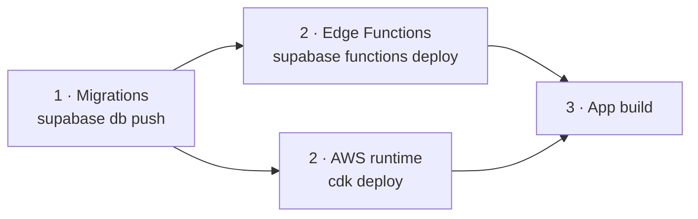

# Backend reference

Lookup tables for every server surface: the runtime API, the database and the
Edge Functions. For how they fit together, read
[Architecture](architecture.md).

- [Runtime API (AWS)](#runtime-api-aws)
- [Database](#database)
  - [Tables](#tables)
  - [RPCs](#rpcs)
  - [Background jobs](#background-jobs)
- [Edge Functions](#edge-functions)
- [Migrations](#migrations)
- [Deploy order](#deploy-order)

## Runtime API (AWS)

Defined in [`infra/lib/infra-stack.ts`](../../infra/lib/infra-stack.ts). Every
route sits behind a Lambda authorizer that validates the caller's **Supabase
access token** (`Authorization: Bearer <jwt>`). The default stage is throttled to
10 requests per second, with bursts of 20.

| Route | Lambda | Returns |
| --- | --- | --- |
| `POST /v1/live-sessions` | `live-session` | One-use Gemini Live token, user-scoped. Start window defaults to 600 s (60–1800) |
| `POST /v1/notebooks/{id}/live-sessions` | `live-session` | Same token, after checking that you own the notebook. 60 s start window |
| `POST /v1/notebooks/{id}/extractions` | `extract-graph` | A validated graph patch for one finalized turn. Idempotent via DynamoDB claims |
| `POST /v1/notebooks/{id}/close` | `close-session` | The notebook's `SessionCard` (v1), saved with `save_session_card` |

A live-session response:

```json
{
  "status": "ready",
  "sessionToken": "auth_tokens/…",
  "expiresAt": "2026-09-06T16:30:00.000Z",
  "newSessionExpiresAt": "2026-09-06T16:10:00.000Z",
  "model": "gemini-3.1-flash-live-preview"
}
```

Tokens live for 30 minutes and are locked to the configured model and audio
output. `newSessionExpiresAt` is the last moment a *new* connection may open,
so fetch a fresh token before then.

Both `extract-graph` and `close-session` call `gemini-2.5-flash` with the
permanent key from Secrets Manager. Neither route ever returns it.

## Database

All tables are in `public`, have **RLS enabled** and are **owner-only**
(`user_id = auth.uid()`). Memory writes go through RPCs, never direct table
writes.

### Tables

| Table | One row per | Key columns |
| --- | --- | --- |
| `profiles` | user | `display_name` |
| `notebooks` | conversation | `title`, `title_source`, `conversation_mode`, `mode_context`, `revision`, `summary`, `entity_count`, `archived_at` |
| `entities` | (notebook, slug) | `id` (slug), `name`, `type`, `description`, `description_source`, `mentions`, `first_seen`, `last_seen`, `questions[]` |
| `relations` | (notebook, relation) | `source_id`, `target_id`, `label`, `superseded_at` |
| `journal_entries` | user utterance | `text`, `entity_ids[]`, `relation_ids[]` (provenance) |
| `follow_ups` | open question | `question`, `reason`, `target_entity_ids[]`, `answered` |
| `asked_questions` | question already asked | Prevents Lumen repeating itself |
| `conversation_turns` | finalized turn | `turn_id`, `speaker`, `input` (`voice`/`typed`), `text`, `spoken_at` |
| `session_cards` | notebook | `conversation_mode`, `source_revision`, `card` (jsonb) |
| `entity_embeddings` | (notebook, entity) | `embedding vector(384)`, `embedding_model`, `content_hash`. **Service role only** |
| `entity_suppressions` | (user, entity) | IDs you removed. Commits drop them |
| `retrieve_rate_limits` | user window | Recall rate limiting |
| `notebook_commit_requests` | commit | Idempotency for `commit_notebook` |
| `conversation_runtime_sessions`, `conversation_runtime_inbox` | runtime session | Server-side conversation runtime state |

**Views:** `user_entities` merges entities by slug across all of a user's
notebooks (`security_invoker = true`, so the caller's RLS applies).

### RPCs

| Function | Called by | Purpose |
| --- | --- | --- |
| `commit_notebook` | app | The **only** memory write path. Applies a graph patch atomically, checks the revision, and is idempotent per `commitRequestId` |
| `get_notebook_snapshot` | app, runtime | Full notebook state, plus `descriptionSource` and suppressed IDs |
| `get_user_graph` | recall | The merged user-scope graph |
| `get_entity_mentions` | app | Journal entries that mention an entity |
| `edit_entity_description` | app | User-authored description, never overwritten by extraction |
| `remove_entity` | app | Delete everywhere and suppress |
| `save_session_card` | close-session λ (user JWT) | Upsert the closing card, ownership-checked |
| `match_entity_embeddings`, `match_user_entity_embeddings` | retrieve-memory | Cosine search. **Service role only** |
| `bump_retrieve_rate` | retrieve-memory | Rate limiting |
| `enqueue_embed_entities`, `embed_reconcile_sweep`, `embed_orphan_prune` | trigger, cron | Embedding upkeep |
| `handle_new_user` | auth trigger | Creates the profile row |

### Background jobs

| Job | Schedule | What it does |
| --- | --- | --- |
| `AFTER INSERT ON entities` trigger | per statement | `pg_net` → `embed-entities` for that notebook |
| Reconcile sweep | every 15 min (`pg_cron`) | Re-embeds anything missing or stale (by `content_hash` + model) |
| Orphan prune | every 30 min (`pg_cron`) | Deletes embeddings whose entity is gone |

Their configuration (`embed_entities_url`, `embed_internal_secret`) is read from
**Vault**, not from `ALTER DATABASE` settings.

## Edge Functions

| Function | JWT | Used by | What it does |
| --- | --- | --- | --- |
| `retrieve-memory` | ✅ | app (the `get_relevant_memory` tool) | Hybrid recall: BM25 + k-hop graph walk, seeded by vector matches. Falls back to lexical. Returns the [`retrieve-memory-v2`](../../contracts/retrieve-memory-v2.schema.json) shape |
| `embed-entities` | ❌ (shared secret) | database trigger, cron | Embeds entities with `gte-small` (384-d), in chunks of 10, re-enqueueing itself |
| `extract-graph` | ✅ | web client only | Legacy extraction. The app uses the AWS route |
| `speak-agent` | ✅ | web client only | ElevenLabs TTS for the web prototype |

The retrieval core in `supabase/functions/_shared/graphloop/` is **vendored**
from `src/lib/graphloop/` by `scripts/sync-graphloop.mjs`. Edit the source,
re-sync, and `scripts/check-graphloop-sync.mjs` will confirm the copies match.

## Migrations

| Migration | Adds |
| --- | --- |
| `20260518…_initial_auth_and_vault` | Profiles, notebooks, entities, relations, entries, follow-ups, RLS |
| `20260617…_journal_entries_provenance` | `entity_ids` / `relation_ids` on entries |
| `20260626…_retrieve_rate_limits` | Recall rate limiting |
| `20260705…_entity_embeddings` (+ trigger, vault config) | pgvector embeddings and upkeep |
| `20260821…_notebook_commit_module` | `commit_notebook`, revisions, snapshot |
| `20260917…_conversation_runtime` | Runtime session and inbox tables |
| `20260928…_conversation_turns` | Server-side transcript |
| `20261020…_user_memory` | `user_entities` view, user-scope reads |
| `20261021…_conversation_modes` | `conversation_mode`, `mode_context` |
| `20261023000000_turn_input` | `conversation_turns.input` |
| `20261023000100_memory_control` | Edit/remove entity, suppressions |
| `20261024…_session_cards` | `session_cards`, `save_session_card` |

> [!WARNING]
> Some migrations replace a function body (for example `_commit_apply_turn`).
> Any later replacement must start from the **most recent** body, not the
> original. Each migration's header says which one that is.

## Deploy order

When a change spans layers:



- **Backward-compatible server first.** A new app may write new columns (such as
  `conversation_turns.input`) or call new routes (`/close`), so it breaks
  against an older backend.
- **Contracts:** a breaking response change gets a new schema version in
  `contracts/`. Ship the server that can serve it before the client that
  requires it.
- **Staging first.** The `Flutter retrieval release gate` workflow
  (`workflow_dispatch`) applies migrations to staging, deploys the
  retrieval functions, proves an authenticated recall works end to end, then
  builds an unsigned iOS release and scans it for bundled credentials.
