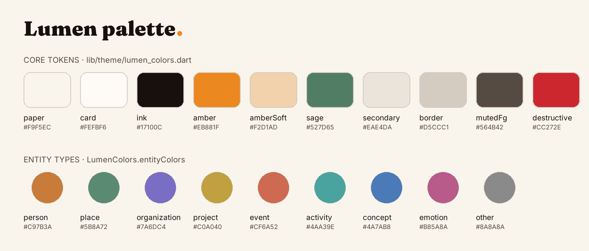
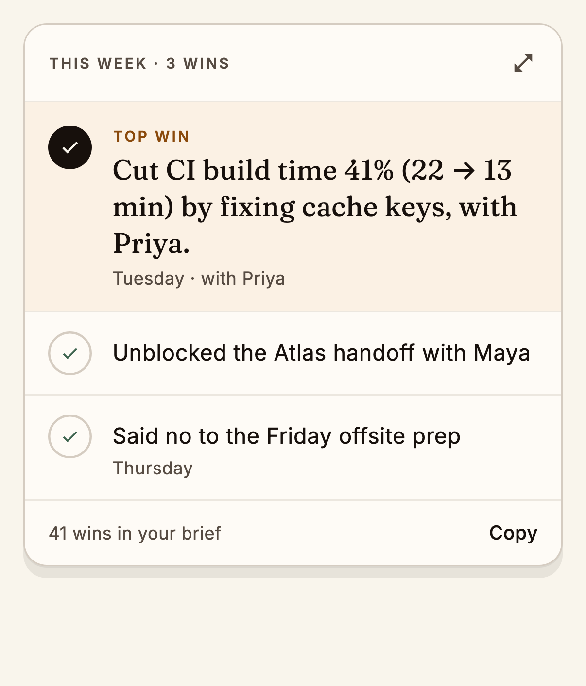
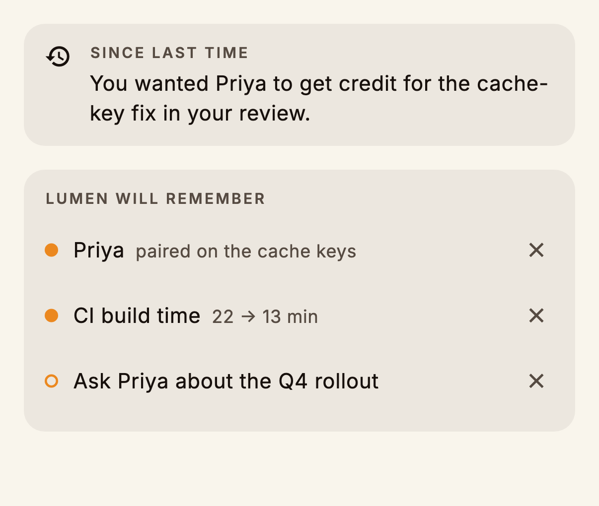
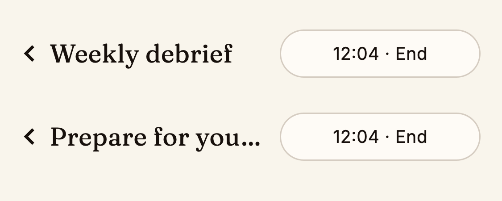

# Design system

Lumen is a **warm, editorial paper-and-ink** surface: a calm journal you talk
into, deliberately not a dark SaaS dashboard. The tokens live in
[`lib/theme/`](../../lib/theme), ported from the web app's OKLCH palette (see
the [visual system audit](../visual-system-audit.md) for the full derivation).



## Colour

Read colours from the theme, never as literals:

```dart
final colors = context.lumenColors; // ThemeExtension<LumenColors>
Container(color: colors.card, child: Text('…', style: TextStyle(color: colors.ink)));
```

| Token | Role |
| --- | --- |
| `paper` | App background. A warm off-white with a faint amber tint |
| `card` | Cards and sheets. Slightly *lighter* than paper, so they float above it |
| `ink` | Primary text, and primary buttons (ink fill, paper text) |
| `amber` | Brand and active state: the mic, the full stop in headlines, *You* labels |
| `amberSoft` | Your transcript bubbles, the top-win highlight |
| `sage` | Lumen's voice: the *Lumen · Speaking* label and its accents |
| `secondary` / `muted` | Quiet fills: Lumen's bubbles, the *Lumen will remember* panel |
| `border` / `input` | Hairlines and field outlines |
| `mutedForeground` | Secondary text, meta lines, eyebrows |
| `destructive` | Removal confirmations only |

**Entity colours** (`LumenColors.entityColors`) are a fixed nine-hue set. Use
them for nodes, legend dots, drawer rows and transcript highlights, so a person
is always the same orange everywhere.

## Type

Two variable fonts, bundled in [`assets/fonts/`](../../assets/fonts):

| Family | Use | Notes |
| --- | --- | --- |
| **Fraunces** | Display: greetings, card titles, Lumen's spoken captions | Explicit `wght` and `opsz` (optical size tracks font size), `SOFT 0`, `WONK 0`. The font's own defaults (wght 900, WONK 1) are wrong for headings |
| **Inter** | UI and body text | 11–16 px scale |

Signature details:

- **The amber full stop.** Headlines end in an amber `.`: "Welcome back,
  Trinab." and "Maya's move and a slower week."
- **Eyebrows**: 10 px Inter, uppercase, 0.14 em tracking (`LumenText.eyebrow`),
  for section labels such as TODAY and WHAT YOU TALKED ABOUT.

## Components

Shared widgets in [`lib/widgets/`](../../lib/widgets):

<table>
<tr>
<td width="50%"></td>
<td width="50%"></td>
</tr>
<tr>
<td><b>ResultCard</b>: the closing card's main block. A highlighted hero row, then checked rows and a footer action</td>
<td><b>ContextTile / ContextList</b>: memory items, optionally removable</td>
</tr>
<tr>
<td></td>
<td></td>
</tr>
<tr>
<td><b>ModeHeader</b>: back chevron, mode title and a trailing action</td>
<td><b>GraphLegend</b>: collapsible key of entity types</td>
</tr>
</table>

Also: `Eyebrow` (section labels) and `NodeGlyph` (the type glyph drawn on
graph nodes).

## Motion

| Moment | Spec |
| --- | --- |
| Voice dock morph (idle ⇄ status tier) | Spring `Cubic(0.34, 1.56, 0.64, 1)`, 520 ms |
| Mic pulse while listening | 2200 ms repeating halo |
| Status-line fade | 220–240 ms ease-out |

Respect *Reduce Motion*: the dock reads `MediaQuery.disableAnimationsOf`
and drops decorative transitions to `Duration.zero`. New animations should
do the same.

## Checking your UI change

Every component above has a preview capture. After a visual change:

```bash
flutter test test/preview_capture_test.dart
```

Then review the diff in `docs/assets/preview-*.png`. See
[Testing → Preview captures](testing.md#preview-captures).
