# User guide

A tour of Lumen, screen by screen. Every image here is rendered from the real
widgets by the [preview-capture test](testing.md#preview-captures), so it
matches the shipping UI.

- [Signing in](#signing-in)
- [Your notebooks](#your-notebooks)
- [Having a conversation](#having-a-conversation)
  - [The voice dock](#the-voice-dock)
  - [Typing instead](#typing-instead)
  - [The transcript page](#the-transcript-page)
- [Your graph](#your-graph)
  - [Entity notes: edit or remove memory](#entity-notes-edit-or-remove-memory)
  - [Exporting a notebook](#exporting-a-notebook)
- [Ending a conversation: the closing card](#ending-a-conversation-the-closing-card)
- [How Lumen remembers](#how-lumen-remembers)
- [Privacy](#privacy)

---

## Signing in

Lumen uses email and password. Create an account from **Create account** on the
sign-in screen. Once signed in you land on your notebooks, and you stay signed in
until you sign out.

## Your notebooks

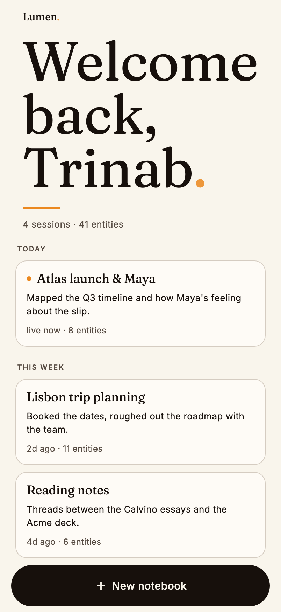

Every conversation lives in a **notebook**. The dashboard greets you and
shows how many sessions and entities you have so far.

Notebooks are grouped by **Today**, **This week** and earlier. Each card shows:

- the notebook's **title** (Lumen names it from what you talked about),
- a one-line **summary**,
- when it was last active (a dot and *live now* if it's in progress), and
- how many **entities** it holds.

Tap a card to reopen it. Lumen replays the earlier turns to itself, so you can
pick up mid-thought. Tap **＋ New notebook** to start fresh. New notebooks use
the *Just talk* mode.

 

## Having a conversation

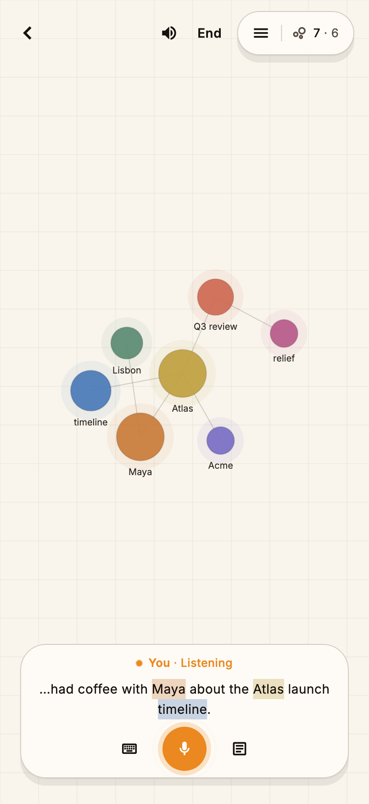

The notebook screen has two layers: your **graph** on a paper grid, and the
**voice dock** floating at the bottom.

**Top bar**

| Control | What it does |
| --- | --- |
| **‹** | Back to *Your notebooks* (ends the session and opens the closing card) |
| 🔊 | Mute or unmute Lumen's voice. The conversation keeps going |
| **End** | End the session |
| ☰ · `7 · 6` | Open the graph drawer. The counts are entities · relations |

When the session starts, Lumen greets you first. The mic opens once the
greeting has played, so you never talk over each other at the start.

Then just talk. As you speak, names Lumen recognizes light up in the live
transcript in their entity colour, and new nodes drift into the graph.

You can **interrupt** Lumen at any time. It stops speaking and listens.

 

### The voice dock

The dock has three buttons: **Type** (keyboard), **Talk** (the mic) and
**View** (switch between graph and transcript). A status line opens above them
to show who has the floor:

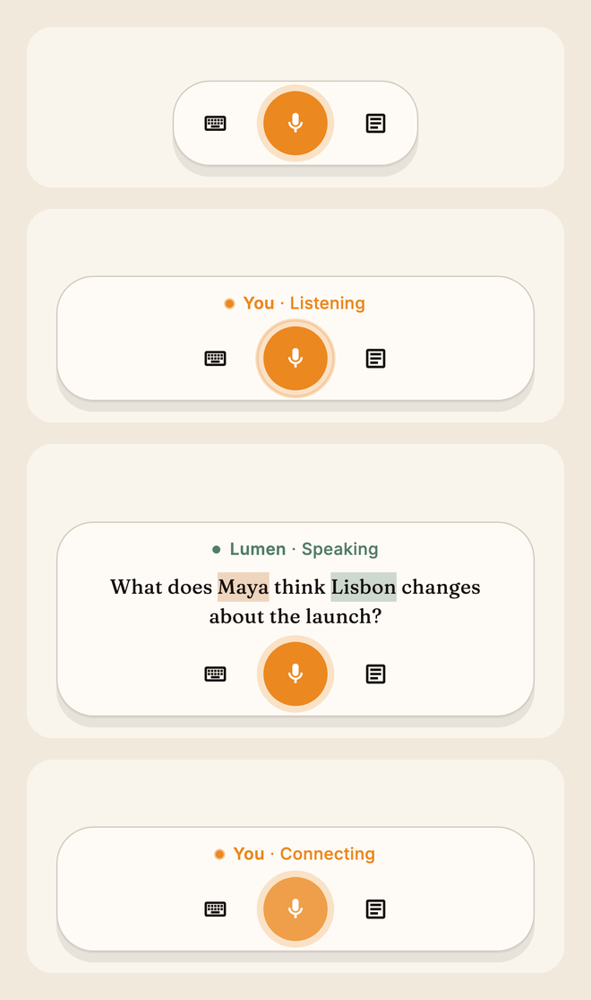

| State | Meaning |
| --- | --- |
| *Idle* | No session running. Tap the mic to start |
| **You · Connecting** | Getting a secure voice session ready |
| **You · Listening** | Your mic is live, with your words shown as they're recognized |
| **Lumen · Speaking** | Lumen's reply, captioned, with entities highlighted |

### Typing instead

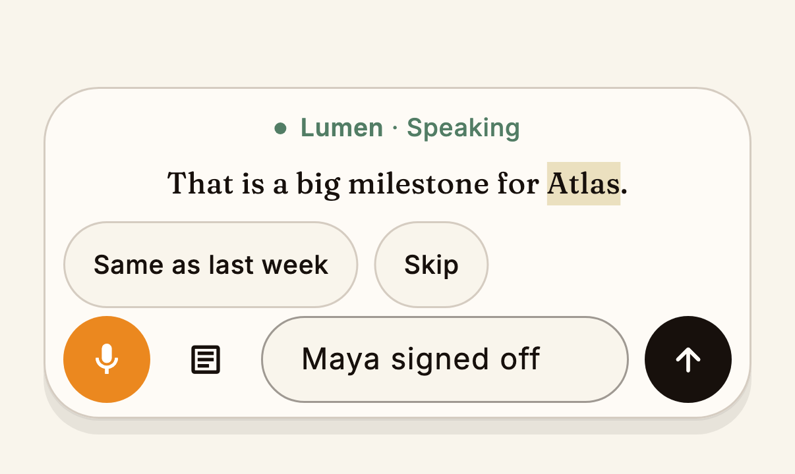

Tap the keyboard (**Type instead**) to switch to text at any point, even
mid-session. Typed turns are treated exactly like spoken ones: they're
extracted, remembered and shown in the transcript. When Lumen asks something
with an obvious short answer, **quick replies** appear above the text field.

### The transcript page

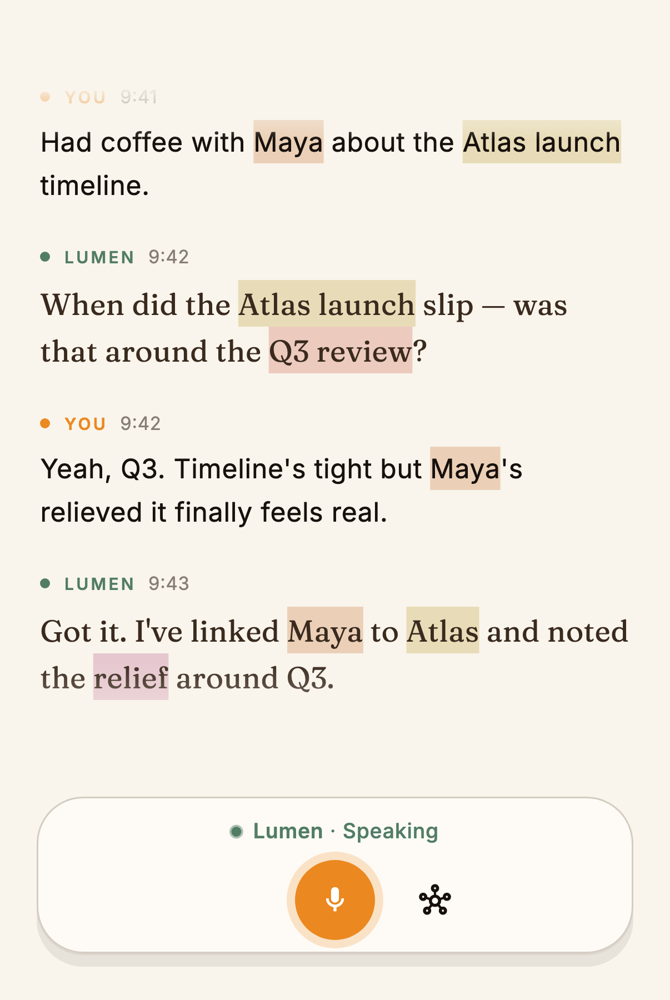

Tap **View** to see the whole conversation. Your turns are amber bubbles on the
right and Lumen's are on the left. A turn that's still being recognized appears
faded until it's final.

## Your graph

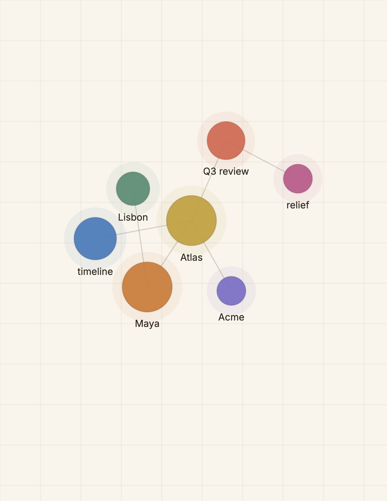

Each **node** is something you mentioned. Its size grows with how often it
comes up. **Lines** are relationships Lumen inferred ("Maya *works on*
Atlas"). Pinch to zoom, drag to pan, tap a node to open its note.

Nodes are coloured by type. Tap the legend to expand it:

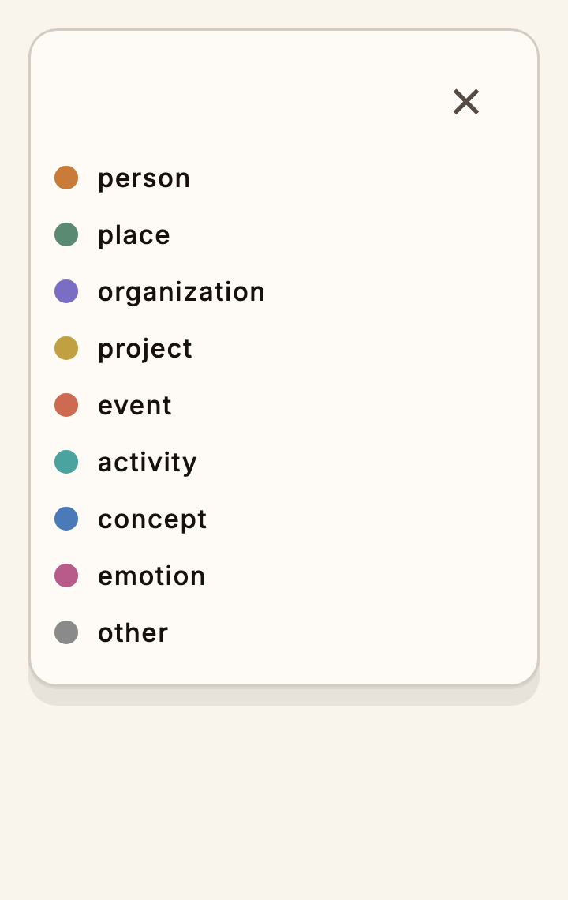

| Colour | Type | Examples |
| --- | --- | --- |
| 🟠 | Person | Maya, Priya |
| 🟢 | Place | Lisbon, Brooklyn |
| 🟣 | Organization | Acme |
| 🟡 | Project | Atlas, CI pipeline |
| 🔴 | Event | Q3 review |
| 🩵 | Activity | running, sleep |
| 🔵 | Concept | timeline |
| 🩷 | Emotion | relief |
| ⚪ | Other | |

**The graph drawer** (☰ in the top bar) lists everything in the notebook,
grouped by type and ranked by mentions:

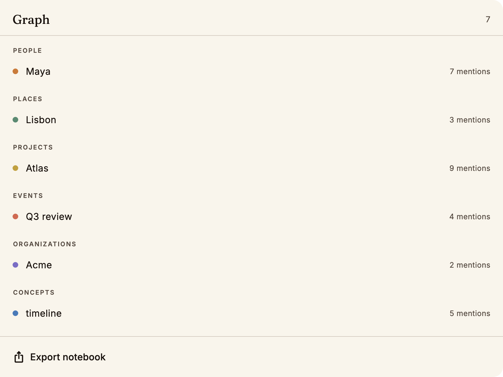

### Entity notes: edit or remove memory

Tap any node or drawer row to open its note: a description, the moments you
mentioned it, and related entities (tap one to jump there).

- **Edit / Add description.** Write it in your own words. Lumen will never
  overwrite a description you wrote.
- **Remove from memory.** Deletes the entity from *every* notebook and stops
  Lumen from re-adding it later. You get an **Undo** right after.

### Exporting a notebook

At the bottom of the drawer, **Export notebook** builds a Markdown vault and
opens the share sheet. The export uses Obsidian-style `[[wikilinks]]`: one note
per entity, plus daily notes linking back to when you said each thing. Drop it
into an Obsidian vault and the graph comes with it.

## Ending a conversation: the closing card

Leaving a notebook (‹ or **End**) takes you to its **closing card**: the result
of the conversation.

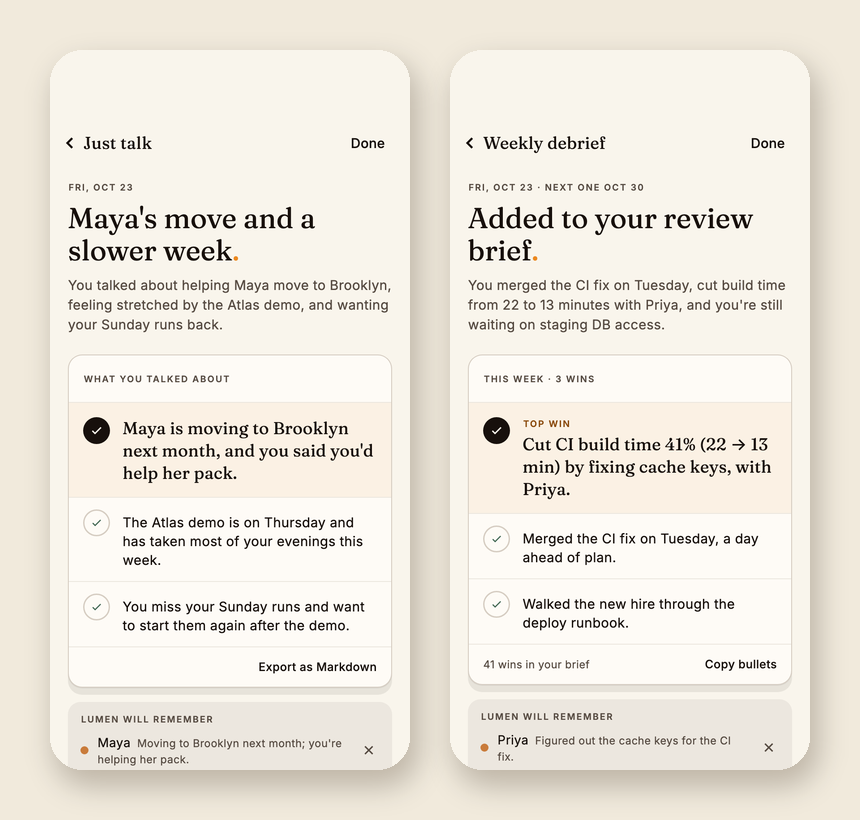

Every card has:

- a **title** and a short **summary** of the conversation,
- the mode-specific body: *What you talked about* for Just talk, or *This week
  · N wins* with a highlighted **Top win** for Weekly debrief,
- an action: **Export as Markdown**, or **Copy bullets** for a review brief, and
- **Lumen will remember**: every memory change this conversation made, with
  *new* marking first-time entities. Tap **✕** on any line to remove it. You get
  five seconds to **Undo** before it's final.

The dock stays at the bottom: tap **Talk** or **Type** to keep going in the same
notebook. Tap **Done** to return to your notebooks. If you come back and add
more, the card is regenerated the next time you leave.

<table>
<tr>
<td>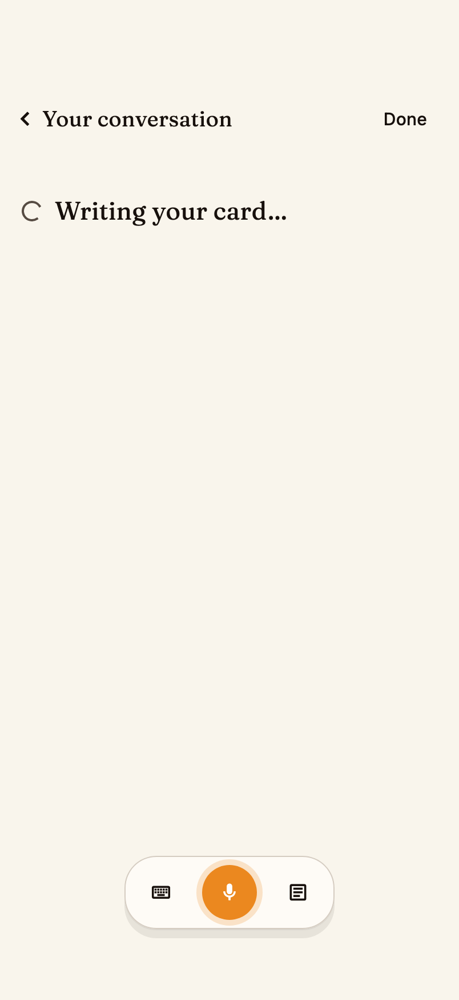</td>
<td>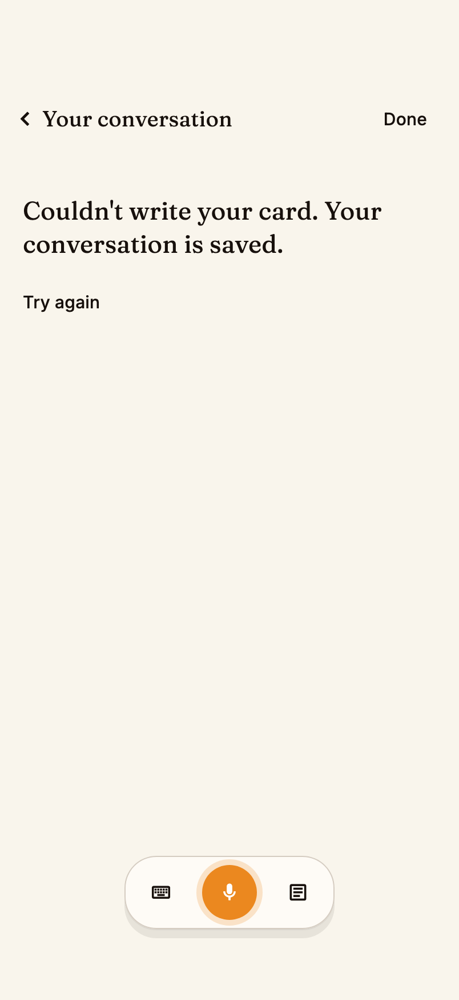</td>
</tr>
<tr>
<td align="center">While the card is being written</td>
<td align="center">If it can't be written: <b>Try again</b></td>
</tr>
</table>

## How Lumen remembers

- After each finished turn, Lumen pulls out the people, places, projects and
  feelings you mentioned, and how they relate. Your words are never rewritten.
- Memory is shared across notebooks. When you mention Maya in a new
  conversation, Lumen can recall what you said about her weeks ago.
- Lumen recalls only when it's useful. It looks things up silently
  mid-conversation, and you'll notice it as a better question, not a search box.
- It asks about what it knows least. Entities with thin descriptions become
  natural follow-up questions.

## Privacy

- Your memory is visible only to you, enforced by the database for every row.
- Lumen's voice connection uses a short-lived, single-use credential. No
  long-lived AI keys are stored on your phone.
- You can edit or remove anything Lumen keeps, at any time.
